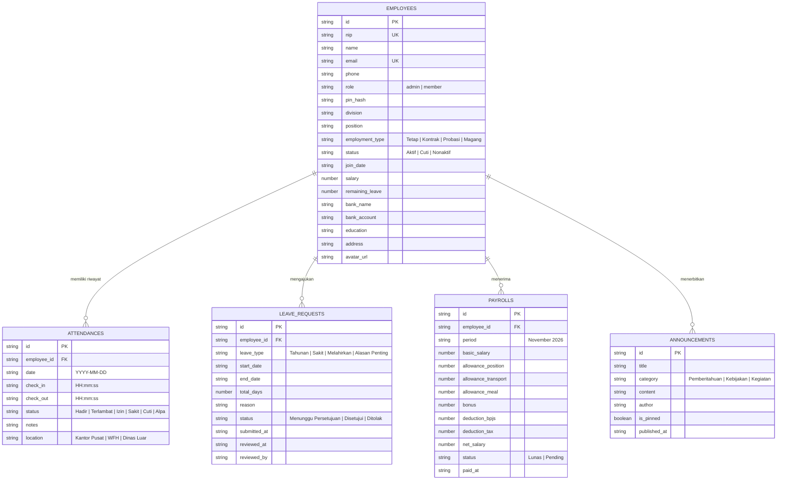

# 📋 PRODUCT REQUIREMENT DOCUMENT (PRD)
## Transformasi Starter Template Menjadi Aplikasi HR Presensi & Monitoring Karyawan (`Mrhands Lab App Demo`)

---

## 1. RINGKASAN EKSEKUTIF & TUJUAN PROYEK

### 1.1 Visi Produk
Aplikasi **Mrhands Lab App Demo** adalah sistem manajemen sumber daya manusia (SDM) modern kelas *enterprise* berbasis web. Sistem ini mencakup **Presensi Mandiri Karyawan (Employee Self-Service / ESS)** dengan jam digital WIB real-time, **Live Attendance Monitoring Board** untuk HR/Manajemen, direktori data pegawai, pengajuan cuti online, penerbitan slip gaji digital, serta papan pengumuman internal perusahaan.

### 1.2 Filosofi Arsitektur: Dual-Mode Zero-Config (No-Break Deployment)
Aplikasi dibangun di atas pondasi arsitektur **Dual-Mode Data Engine**:
1. **Mode 1: SQLite Zero-Config Local Storage (Default)**:
   - Aplikasi dapat langsung diuji coba 100% secara interaktif tanpa perlu instalasi server database atau pengisian kredensial pihak ketiga.
   - Menggunakan engine in-memory dan browser `localStorage` dengan skema terstruktur SQLite 3.
2. **Mode 2: Supabase Cloud PostgreSQL**:
   - Otomatis aktif saat environment variable `VITE_SUPABASE_URL` dan `VITE_SUPABASE_ANON_KEY` tersedia di `.env`.
   - Menggunakan query SQL PostgreSQL live dengan proteksi Row Level Security (RLS).
   - *Graceful Fallback*: Jika koneksi Supabase terputus, sistem secara otomatis beralih kembali ke SQLite lokal tanpa membuat aplikasi crash.

### 1.3 Tech Stack Inti
- **Framework**: TanStack Start + Vite 7 + React 19.
- **Routing**: TanStack Router (File-Based Type-Safe Routing di `src/routes/`).
- **Styling**: Tailwind CSS v4 dengan variabel warna modern format OKLCH di `src/styles.css`.
- **Data Fetching & State**: `@tanstack/react-query` v5.
- **Visualisasi Grafik**: `recharts` (Responsive Container, custom tooltip OKLCH).
- **Notifikasi**: `sonner` Toaster.
- **Icons**: `lucide-react`.

---

## 2. PENGGUNA & PERAN SISTEM (USER ROLES & PERSONAS)

| Peran (Role) | Akses URL | Fitur Utama | Kredensial Demo Default |
| :--- | :--- | :--- | :--- |
| **HR Administrator** | `/admin/*` | Dashboard Eksekutif, Live Monitoring Presensi, Manajemen Pegawai, Review & Approval Cuti, Penggajian & Slip Gaji, Papan Pengumuman. | Username / NIP: `admin` atau `198801012010121001`<br>PIN: `000000` / `123456` |
| **Karyawan (Member / ESS)** | `/dashboard/*` | Presensi Masuk & Pulang (WIB), Riwayat Kehadiran Personal, Pengajuan Cuti & Cek Saldo Cuti, Unduh/Lihat Slip Gaji Digital, Profil Pegawai. | NIP: `199003152015021002`<br>PIN: `123456` |
| **Publik (Tamu)** | `/`, `/login`, `/transparency` | Halaman Depan Produk, Akses Demo 1-Klik, Direktori Karyawan & Transparansi Organisasi. | Tanpa login |

---

## 3. MODEL DATA & SPESIFIKASI SKEMA DATABASE

### 3.1 Skema Relasional (5 Entitas Utama)



### 3.2 File Definisi TypeScript: `src/lib/employee-data.ts`
File ini wajib berisi:
1. Definisi antarmuka TypeScript untuk `Employee`, `Attendance`, `LeaveRequest`, `Payroll`, `Announcement`, dan `HRDashboardMetrics`.
2. Formatters Indonesia:
   - `formatRupiah(value: number): string`
   - `formatCompact(value: number): string` (Rp 1.2 Jt, Rp 3.5 M)
   - `formatDateIndo(dateStr: string): string` (17 Nov 2026)
3. Kumpulan data awal (*Seed Data*) mencakup **10 karyawan realistis Indonesia** dari berbagai divisi (Teknologi Informasi, SDM, Keuangan, Operasional, Pemasaran, Legal).
4. Data tren absensi mingguan dan data grafik distribusi divisi untuk visualisasi Recharts.

---

## 4. SERVICE LAYER: `src/services/employee-service.ts`

Setiap fungsi wajib menerapkan logika *Dual-Mode*:
1. Periksa `if (isSupabaseConfigured && supabase)`.
2. Lakukan operasi ke Supabase di dalam blok `try { ... }`.
3. Jika gagal atau jika Supabase tidak dikonfigurasi, gunakan engine SQLite lokal di `src/lib/sqlite.ts`.

### Daftar Fungsi yang Harus Diimplementasikan:
- **Karyawan**:
  - `getEmployees(): Promise<Employee[]>`
  - `getEmployeeById(id: string): Promise<Employee | null>`
  - `getEmployeeByNip(nip: string): Promise<Employee | null>`
  - `addEmployee(emp: Omit<Employee, "id">): Promise<Employee>`
  - `updateEmployee(id: string, updates: Partial<Employee>): Promise<Employee>`
  - `deleteEmployee(id: string): Promise<void>`
- **Presensi (Attendance)**:
  - `getAttendances(): Promise<Attendance[]>`
  - `getTodayAttendance(employeeId: string): Promise<Attendance | null>`
  - `recordAttendance(employeeIdOrNip: string, type: "check_in" | "check_out", location?: string): Promise<Attendance>`
    - *Aturan Bisnis*: Jika jam check-in melewati pukul `08:30:00 WIB`, tandai status sebagai `Terlambat`. Jika sebelumnya, status adalah `Hadir`.
- **Cuti (Leave Requests)**:
  - `getLeaveRequests(): Promise<LeaveRequest[]>`
  - `submitLeaveRequest(req: Omit<LeaveRequest, "id" | "status" | "submitted_at">): Promise<LeaveRequest>`
  - `updateLeaveStatus(id: string, status: "Disetujui" | "Ditolak", reviewerName: string): Promise<LeaveRequest>`
    - *Aturan Bisnis*: Jika cuti tahunan `Disetujui`, kurangi `remaining_leave` karyawan terkait sebanyak `total_days`.
- **Penggajian (Payroll)**:
  - `getPayrolls(): Promise<Payroll[]>`
  - `generatePayroll(period: string): Promise<number>` (Generate batch payroll untuk semua karyawan aktif).
- **Pengumuman**:
  - `getAnnouncements(): Promise<Announcement[]>`
  - `addAnnouncement(ann: Omit<Announcement, "id" | "published_at">): Promise<Announcement>`
  - `deleteAnnouncement(id: string): Promise<void>`
- **Dashboard Metrics**:
  - `getHRDashboardMetrics(): Promise<HRDashboardMetrics>`
    - Mengembalikan kalkulasi total karyawan, jumlah hadir hari ini, jumlah terlambat, jumlah cuti/izin, permohonan cuti pending, dan total pengeluaran gaji bulan ini.

---

## 5. SPESIFIKASI STRUKTUR ROUTE (TANSTACK ROUTER)

Aplikasi memiliki total 13 halaman type-safe di bawah direktori `src/routes/`:

```
src/routes/
├── __root.tsx                    # Root Layout, QueryClientProvider, Toaster
├── index.tsx                     # Landing Page Publik & Hero Demo
├── login.tsx                     # Halaman Masuk & 1-Klik Akses Demo
├── transparency.tsx              # Direktori Karyawan & Transparansi Publik
├── admin.tsx                     # Guard Layout Administrator (Cek Sesi Admin)
│   ├── admin.index.tsx           # Executive HR Dashboard & Analitik Recharts
│   ├── admin.attendance.tsx      # Live Monitoring Kehadiran Harian & CSV Export
│   ├── admin.employees.tsx       # Manajemen Pegawai (Tabel & Modal Tambah Pegawai)
│   ├── admin.leaves.tsx          # Review & Persetujuan Pengajuan Cuti
│   ├── admin.payroll.tsx         # Manajemen Penggajian & Penerbitan Slip Gaji
│   └── admin.announcements.tsx   # Papan Pengumuman & Siaran Internal
└── dashboard.tsx                 # Guard Layout Karyawan (Cek Sesi Member)
    ├── dashboard.index.tsx       # Beranda Karyawan (Jam WIB & Tombol Presensi)
    ├── dashboard.attendance.tsx  # Riwayat Presensi Personal
    ├── dashboard.leaves.tsx      # Pengajuan Cuti Personal & Saldo Cuti
    ├── dashboard.payroll.tsx     # Slip Gaji Digital Interaktif (Cetak / PDF)
    └── dashboard.profile.tsx     # Profil Pegawai & Kontak Darurat
```

### 5.1 Rincian Halaman Admin
1. **`src/routes/admin.index.tsx`**:
   - 4 Kartu KPI: Total Karyawan Aktif, Tingkat Kehadiran Hari Ini (%), Pengajuan Cuti Menunggu Review, Total Payroll Bulan Ini.
   - 3 Grafik Recharts:
     - AreaChart: Tren Persentase Kehadiran 7 Hari Terakhir.
     - BarChart: Distribusi Karyawan per Divisi.
     - PieChart: Komposisi Status Kepegawaian (Tetap, Kontrak, Probasi).
   - Quick Action: Tombol langsung ke Tambah Karyawan dan Review Cuti.
2. **`src/routes/admin.attendance.tsx`**:
   - Filter Status Kehadiran (Semua, Hadir, Terlambat, Izin/Sakit, Cuti, Alpa).
   - Filter Tanggal & Input Pencarian Nama/NIP.
   - Tabel monitoring dengan indikator waktu check-in, check-out, lokasi kerja (Kantor / WFH), dan badge status warna-warni.
   - Tombol **Export CSV** untuk pelaporan absensi bulanan.
3. **`src/routes/admin.employees.tsx`**:
   - Filter Divisi dan Status Karyawan.
   - Modal pop-up **Tambah Karyawan Baru** (NIP, Nama, Email, Divisi, Jabatan, Gaji Pokok, Pendidikan, No Rekening).
   - Aksi Edit status karyawan dan hapus data.
4. **`src/routes/admin.leaves.tsx`**:
   - Tab permohonan: Menunggu Persetujuan vs Riwayat Cuti Selesai.
   - Modal konfirmasi persetujuan (Approve) dengan pengurangan otomatis saldo cuti atau penolakan (Reject) beserta alasan.
5. **`src/routes/admin.payroll.tsx`**:
   - Tabel rekapitulasi gaji per periode (Gaji Pokok, Tunjangan, Potongan BPJS & PPh 21, Gaji Bersih).
   - Tombol **Generate Payroll Periode Berjalan**.
   - Modal pop-up **Lihat Slip Gaji Resmi** dengan format standar siap cetak.
6. **`src/routes/admin.announcements.tsx`**:
   - Form pembuatan siaran pengumuman baru (Judul, Kategori, Isi Pengumuman, Pin to Top).
   - Daftar pengumuman aktif dengan opsi hapus.

### 5.2 Rincian Halaman Karyawan (ESS)
1. **`src/routes/dashboard.index.tsx`**:
   - Banner sambutan personal dengan NIP dan Divisi.
   - **Widget Jam Digital WIB Real-time** (Detik berdetik halus).
   - **Tombol Presensi Interaktif**:
     - Status 1 (Belum Presensi): Tombol hijau "Presensi Masuk Sekarang".
     - Status 2 (Sudah Masuk): Badge jam masuk + Tombol biru "Presensi Pulang".
     - Status 3 (Selesai): Indikator centang hijau "Presensi Hari Ini Lengkap".
   - Ringkasan sisa cuti tahunan dan pengumuman terbaru.
2. **`src/routes/dashboard.attendance.tsx`**:
   - Tabel riwayat presensi bulan berjalan dengan badge status, jam masuk, jam pulang, dan durasi kerja.
3. **`src/routes/dashboard.leaves.tsx`**:
   - Kartu info saldo cuti tahunan (Tersisa X hari dari total 12 hari).
   - Form pengajuan cuti baru: Pilihan jenis cuti, tanggal mulai, tanggal selesai, dan alasan cuti.
   - Tabel riwayat pengajuan cuti beserta status persetujuan dari HR.
4. **`src/routes/dashboard.payroll.tsx`**:
   - Daftar slip gaji bulanan karyawan.
   - Tampilan rincian komponen penerimaan (Gaji Pokok, Tunjangan Jabatan, Uang Makan, Transport) dan potongan (BPJS Kesehatan/Ketenagakerjaan, PPh 21).
   - Tombol cetak slip gaji.
5. **`src/routes/dashboard.profile.tsx`**:
   - Kartu data diri lengkap, nomor rekening bank penerimaan gaji, riwayat pendidikan, dan alamat domisili.

### 5.3 Rincian Halaman Publik
1. **`src/routes/index.tsx`**:
   - Hero banner profesional bernuansa korporat Indonesia.
   - 1-Klik shortcut demo ke Admin (`/admin`) dan Karyawan (`/dashboard`).
   - Penjelasan fitur unggulan (Presensi WIB, Dual-Mode Database, Recharts Analytics).
2. **`src/routes/login.tsx`**:
   - Form input manual NIP & PIN (Default: `123456` / `000000`).
   - **2 Tombol Demo Login 1-Klik**:
     - *Login HR Admin* (Langsung masuk sebagai Dr. Hendra Gunawan).
     - *Login Karyawan* (Langsung masuk sebagai Budi Santoso - Lead Engineer).
3. **`src/routes/transparency.tsx`**:
   - Direktori tim publik yang menampilkan struktur organisasi dan daftar staf per divisi secara transparan.

---

## 6. PANDUAN EKSEKUSI STEP-BY-STEP UNTUK ANTIGRAVITY (AI AGENT ROADMAP)

Ketika AI Agent (Antigravity) membaca PRD ini untuk membangun aplikasi dari starter template kosongan, lakukan eksekusi dengan urutan fase berikut:

### FASE 1: Data Model, Formatters & Mock Seed
1. Buat file `src/lib/employee-data.ts`.
   - Salin seluruh antarmuka TypeScript untuk `Employee`, `Attendance`, `LeaveRequest`, `Payroll`, `Announcement`.
   - Buat array 10 karyawan dummy Indonesia dengan data lengkap.
   - Tulis fungsi `formatRupiah`, `formatCompact`, dan `formatDateIndo`.
2. Perbarui `src/lib/sqlite.ts`.
   - Tambahkan skema DDL untuk tabel `employees`, `attendances`, `leave_requests`, `payrolls`, `announcements`.
   - Hubungkan fungsi pembacaan/penulisan tabel lokal dengan `localStorage`.

### FASE 2: Service Layer & Supabase Schema
1. Buat file `src/services/employee-service.ts`.
   - Implementasikan seluruh fungsi data dengan pola *Dual-Mode* (Supabase query dengan fallback ke SQLite).
2. Perbarui `src/services/auth-service.ts`.
   - Tambahkan fungsi autentikasi `loginWithNipPin(nip, pin)` dan `loginAsDemo(role, specificNip)`.
3. Tulis skema DDL Supabase di `supabase/schema.sql` dan data seed di `supabase/seed.sql`.

### FASE 3: App Shell & Navigasi
1. Perbarui `src/components/app-shell.tsx`.
   - Tambahkan item menu navigasi Admin: Dashboard, Presensi Harian, Karyawan, Cuti, Penggajian, Pengumuman.
   - Tambahkan item menu navigasi Karyawan: Beranda, Presensi Saya, Cuti Saya, Slip Gaji, Profil Saya.
   - Pastikan tombol *Quick Switch Role* (Beralih ke Admin / Member) berfungsi secara instan di navbar atas.

### FASE 4: Halaman Publik & Autentikasi
1. Perbarui `src/routes/index.tsx` (Landing page dengan branding Mrhands Lab App Demo).
2. Perbarui `src/routes/login.tsx` (Form NIP/PIN + 2 tombol demo 1-klik).
3. Buat file `src/routes/transparency.tsx` (Direktori staf publik).

### FASE 5: Halaman Admin (/admin/*)
1. Perbarui `src/routes/admin.index.tsx` (Overview eksekutif + grafik Recharts).
2. Buat `src/routes/admin.attendance.tsx` (Live monitoring board + export CSV).
3. Buat `src/routes/admin.employees.tsx` (CRUD Karyawan + modal tambah staf).
4. Buat `src/routes/admin.leaves.tsx` (Persetujuan cuti & kalkulasi saldo).
5. Buat `src/routes/admin.payroll.tsx` (Rekap gaji & modal slip gaji).
6. Buat `src/routes/admin.announcements.tsx` (Manajemen siaran pengumuman).

### FASE 6: Halaman Karyawan (/dashboard/*)
1. Perbarui `src/routes/dashboard.index.tsx` (Jam WIB live, tombol check-in/out dinamis).
2. Buat `src/routes/dashboard.attendance.tsx` (Riwayat absensi personal).
3. Buat `src/routes/dashboard.leaves.tsx` (Form pengajuan cuti & saldo).
4. Buat `src/routes/dashboard.payroll.tsx` (Slip gaji digital).
5. Buat `src/routes/dashboard.profile.tsx` (Profil data diri).

### FASE 7: Verifikasi & Jaminan Kualitas (QA Gates)
1. Jalankan `npx tsc --noEmit` untuk memastikan **0 type error**.
2. Jalankan `npm run build` untuk memverifikasi proses build client & SSR Vite berjalan sempurna.
3. Jalankan server demo `npm run dev` dan verifikasi seluruh rute melalui browser.

---

## 7. ATURAN KUALITAS & HIGIENITAS KODE (ANTI-SLOP RULES)

1. **Dilarang Menulis Komentar Slop**: Hindari komentar basi seperti `// This handles the click event`. Beri komentar hanya pada logika bisnis penting seperti batas toleransi keterlambatan 08:30 WIB.
2. **Tanpa Mock Mati**: Seluruh tombol, modal, filter status, dan form input wajib berfungsi secara interaktif dan terhubung ke state TanStack Query atau SQLite.
3. **Bahasa Indonesia Standar Enterprise**: Gunakan terminologi profesional seperti *Presensi, Divisi, NIP, Sisa Cuti, Gaji Bersih, Tanggal Terbit*.
4. **Respon Cepat & Umpan Balik**: Setiap mutasi data wajib menampilkan notifikasi `toast.success()` atau `toast.error()` dari `sonner`.
