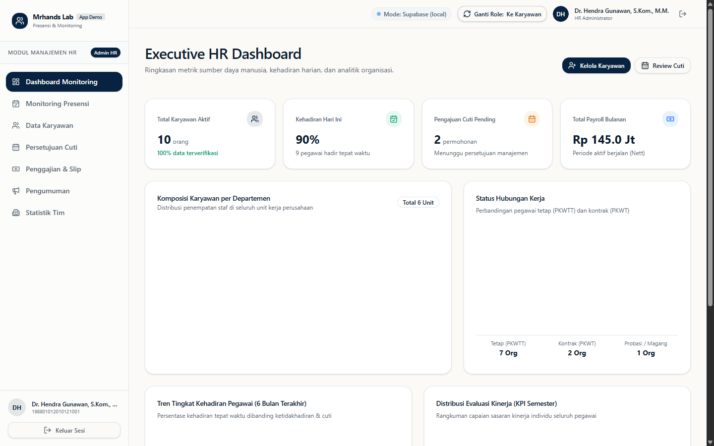
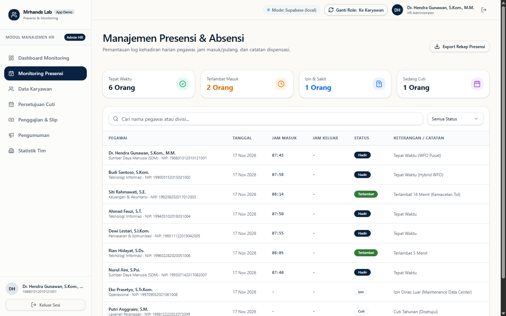
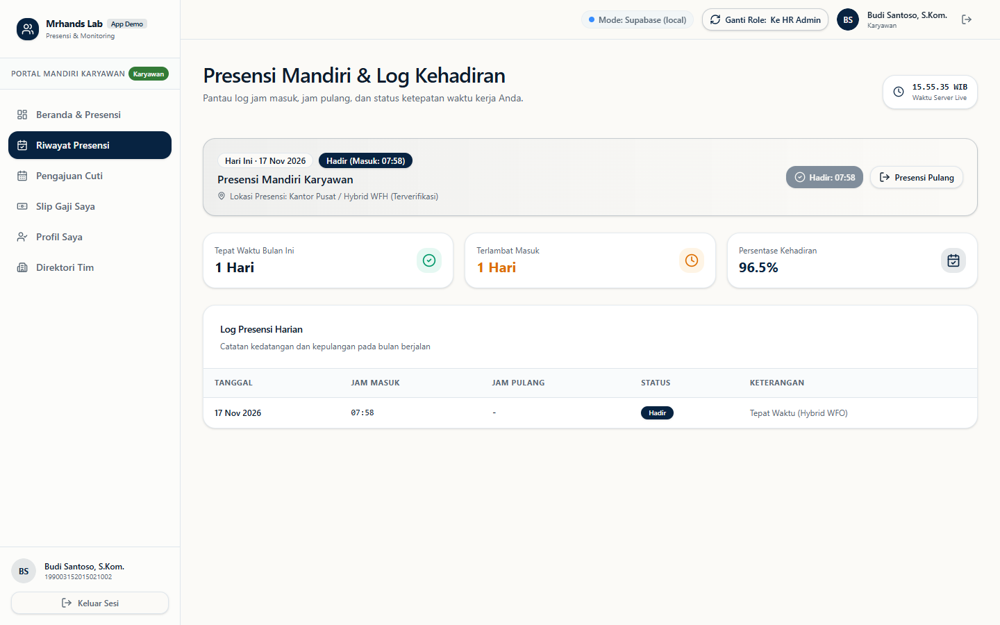
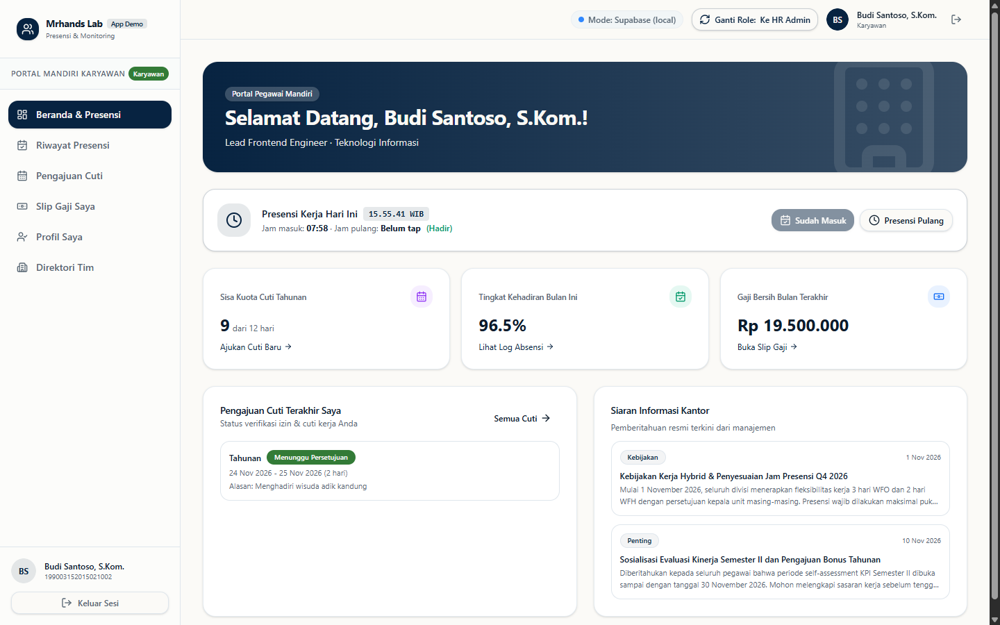
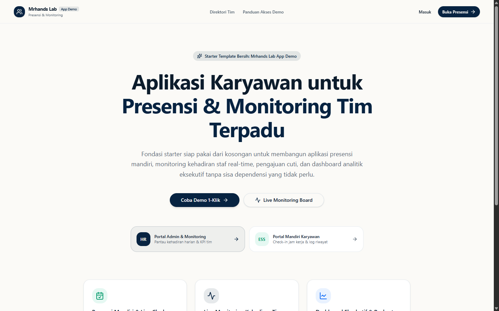
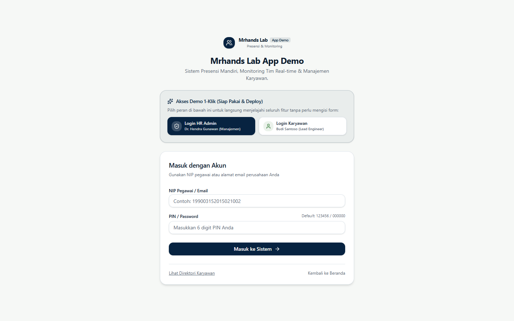
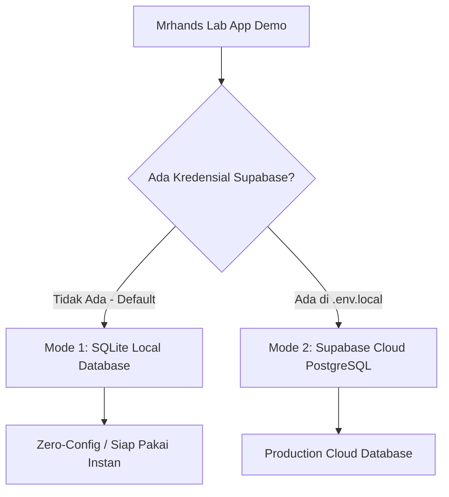

# 🏢 Mrhands Lab App Demo — Presensi & Monitoring Karyawan

> **Starter Kit Aplikasi Web Enterprise Modern** dari nol berbasis **TanStack Start (Vite + React 19)**, **Tailwind CSS v4 (OKLCH)**, **SQLite (Local Zero-Config)**, **Supabase PostgreSQL (Cloud)**, **Recharts**, dan **Radix UI**.
>
> Proyek ini dirancang sebagai starter template bersih (*clean starter from scratch*) tanpa sisa dependensi lama, siap dijalankan langsung untuk mendemokan sistem presensi mandiri dan monitoring kehadiran tim.

---

## 📸 Preview Tangkapan Layar Aplikasi (Live Demo Screenshots)

### 1. Dashboard Eksekutif & Analitik Kehadiran (Admin Portal)

*Visualisasi KPI kehadiran harian, tren 6 bulan Recharts, dan komposisi staf per departemen.*

---

### 2. Live Monitoring Presensi Staf Real-Time (HR & Manajemen)

*Tabel pemantauan kedatangan karyawan hari ini, deteksi toleransi keterlambatan, filter status (Hadir, Terlambat, Izin, Sakit, Cuti, Alpa), dan tombol export CSV.*

---

### 3. Presensi Mandiri Karyawan & Jam Live WIB (*Employee Self-Service / ESS*)

*Fitur Check-in dan Check-out mandiri dengan sinkronisasi jam digital WIB, indikator lokasi WFO/WFH, dan riwayat absensi bulanan.*

---

### 4. Beranda Karyawan & Ringkasan Kompensasi

*Portal mandiri pegawai untuk memantau kehadiran hari ini, status permohonan cuti, slip gaji digital, dan pengumuman kantor.*

---

### 5. Halaman Utama / Landing Page & Akses Demo 1-Klik
| Landing Page Starter | Halaman Masuk & 1-Klik Demo |
| :---: | :---: |
|  |  |

---

## 🗄️ Dua Mode Database: SQLite & Supabase

Aplikasi ini didesain dengan arsitektur **Dual-Mode Data Architecture** agar siapa pun dapat langsung mencoba aplikasi tanpa hambatan instalasi:



### 🟢 Mode 1: SQLite Database (Local Zero-Config — Default)
- **Langsung Aktif**: Tidak perlu menginstal Docker, PostgreSQL, atau registrasi akun pihak ketiga.
- **Skema SQL Standar**: Menggunakan skema DDL SQLite lengkap di [`sqlite/schema.sql`](sqlite/schema.sql).
- **Fitur Lengkap**: Mendukung query data pegawai, penambahan pegawai baru, presensi masuk/pulang, pencatatan keterlambatan, dan pengajuan cuti secara persisten.
- **Indikator**: Header menampilkan badge hijau `Mode: SQLite (Local Zero-Config)`.

### 🔵 Mode 2: Supabase (Cloud PostgreSQL)
- **Untuk Production**: Terhubung ke database relasional PostgreSQL cloud Supabase.
- **Aktivasi Mudah**: Cukup isi `VITE_SUPABASE_URL` dan `VITE_SUPABASE_ANON_KEY` di `.env.local`.
- **Indikator**: Header otomatis beralih menampilkan badge biru `Mode: Supabase (cloud)`.

---

## ⚡ Cara Menjalankan Aplikasi (Quick Start)

### 1. Pasang Dependensi
```bash
# Menggunakan npm atau yarn
npm install
# atau
yarn install
```

### 2. Jalankan Server Development
```bash
npm run dev
```

Buka peramban Anda di: **`http://localhost:8081`** (atau port yang tertera di terminal).

---

## 🔑 Akun Demo 1-Klik

Pada halaman `/login`, Anda tidak perlu mengetik kredensial manual. Cukup klik tombol demo:

| Akun Demo | Peran (*Role*) | NIP | PIN Default | Hak Akses |
| :--- | :--- | :--- | :--- | :--- |
| **Dr. Hendra Gunawan** | HR Administrator | `198801012010121001` | `000000` | `/admin` (Monitoring & KPI) |
| **Nurul Aini, S.Psi.** | HR Administrator | `199307142017082007` | `000000` | `/admin` (Talent & Cuti) |
| **Budi Santoso, S.Kom.** | Karyawan (Lead Eng.) | `199003152015021002` | `123456` | `/dashboard` (Presensi Mandiri) |
| **Siti Rahmawati, S.E.** | Karyawan (Finance) | `199208202017012003` | `123456` | `/dashboard` (Presensi Mandiri) |

---

## 📁 Struktur Direktori Bersih

```text
├── src/
│   ├── components/            # Komponen antarmuka & layout shell
│   │   ├── app-shell.tsx      # Sidebar, navbar, switcher peran, badge mode DB
│   │   ├── page-header.tsx    # Header judul halaman
│   │   └── ui/                # Primitif UI (Radix & Tailwind v4)
│   ├── lib/                   # Utilitas & Engine Database
│   │   ├── sqlite.ts          # Engine SQLite Local Zero-Config
│   │   ├── supabase.ts        # Client Supabase & pendeteksi mode
│   │   ├── employee-data.ts   # Tipe TypeScript & seed data awal
│   │   └── utils.ts           # Helper styling (cn)
│   ├── routes/                # File-based Routing (TanStack Router)
│   │   ├── __root.tsx         # Root Shell & Global Providers
│   │   ├── index.tsx          # Landing page
│   │   ├── login.tsx          # Halaman masuk dengan demo 1-klik
│   │   ├── admin.index.tsx    # Executive KPI Dashboard
│   │   ├── admin.attendance.tsx # Live Monitoring Presensi Staf
│   │   ├── admin.employees.tsx  # CRUD Manajemen Data Pegawai
│   │   ├── admin.leaves.tsx     # Persetujuan Cuti & Izin
│   │   ├── dashboard.index.tsx      # Beranda Karyawan
│   │   ├── dashboard.attendance.tsx # Presensi Mandiri (Check-in/out)
│   │   └── transparency.tsx   # Direktori Tim Publik
│   └── services/              # Service Layer Dual-Mode
│       ├── auth-service.ts    # Otentikasi NIP/PIN
│       └── employee-service.ts# Operasi CRUD (SQLite / Supabase)
├── sqlite/
│   └── schema.sql             # Skema DDL & Seed Data SQLite
├── supabase/
│   ├── schema.sql             # Skema DDL PostgreSQL Supabase
│   ├── seed.sql               # Seed Data Supabase
│   └── README.md              # Panduan Setup Cloud
├── public/screenshots/        # Dokumentasi visual untuk GitHub
└── README.md                  # Dokumentasi proyek utama
```

---

## 🛠️ Panduan Menambah Fitur Baru dari Nol

### 1. Menambah Route Halaman Baru
Buat file di `src/routes/admin.nama-fitur.tsx`:
```tsx
import { createFileRoute } from "@tanstack/react-router";

export const Route = createFileRoute("/admin/nama-fitur")({
  head: () => ({ meta: [{ title: "Fitur Baru · Mrhands Lab App Demo" }] }),
  component: FiturBaruPage,
});

function FiturBaruPage() {
  return <div className="p-4">Fitur Baru Siap Dikembangkan</div>;
}
```

### 2. Mengakses Database Dual-Mode
Semua fungsi mutasi di `src/services/employee-service.ts` otomatis mendukung mode ganda:
```typescript
export async function getContohData() {
  if (isSupabaseConfigured && supabase) {
    // Mode 2: Query ke Supabase Cloud
    const { data } = await supabase.from("tabel").select("*");
    if (data) return data;
  }
  // Mode 1: Query ke SQLite Local Engine
  return sqliteDB.employees.select();
}
```

---

## 📜 Lisensi & Atribusi

Proyek ini dikembangkan oleh **Mrhands Lab** sebagai starter kit aplikasi presensi & monitoring karyawan. Bebas dimodifikasi untuk pengembangan proyek mandiri maupun enterprise.
