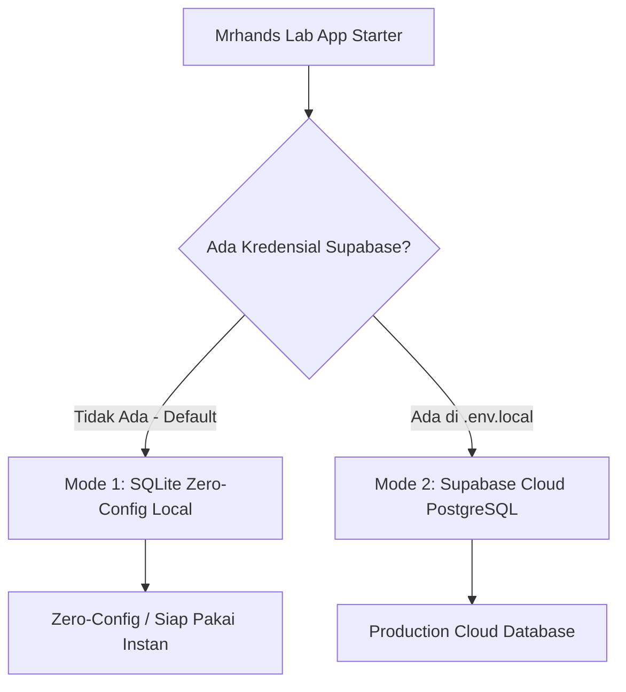

# 🚀 Mrhands Lab App Starter — Blank Starter Template

> **Blank Starter Template Modern** dari nol berbasis **TanStack Start (Vite + React 19)**, **TanStack Router (File-Based)**, **Tailwind CSS v4 (OKLCH)**, **SQLite Zero-Config (Mode 1)**, **Supabase Cloud PostgreSQL (Mode 2)**, dan **Recharts**.
>
> 📌 **Branch ini (`starter`) adalah fondasi bersih tanpa fitur bisnis spesifik**, dirancang khusus agar Anda atau AI Coding Agent (seperti **Antigravity**, **Cursor**, atau **Claude Code**) dapat membangun aplikasi impian dari kosongan sesuai spesifikasi yang ditentukan.

---

## 📋 Dokumen PRD: Membangun Aplikasi HR Presensi & Monitoring Karyawan

Ingin membangun aplikasi HR lengkap dari template starter ini?
Seluruh spesifikasi teknis, model data relasional, desain UI/UX, dan panduan eksekusi langkah demi langkah telah disiapkan di:

👉 **[Buka Dokumen PRD Lengkap (PRD.md)](PRD.md)**

Cukup berikan instruksi berikut kepada AI Agent Anda:
> *"Tolong baca `PRD.md` dan eksekusi pembangunan aplikasi HR Presensi & Monitoring Karyawan (`Mrhands Lab App Demo`) langkah demi langkah sampai selesai."*

*(Untuk melihat versi hasil jadi yang sudah lengkap dan siap deploy, Anda dapat beralih ke branch `main`).*

---

## 🗄️ Arsitektur Dual-Mode Database (SQLite & Supabase)

Starter template ini menerapkan arsitektur **Dual-Mode Data Architecture** agar aplikasi selalu dapat berjalan interaktif tanpa konfigurasi manual:



1. **Mode 1: SQLite Local (Default)**:
   - Langsung aktif tanpa konfigurasi.
   - Menggunakan model tabel SQLite di [`sqlite/schema.sql`](sqlite/schema.sql) dan browser persistence di `src/lib/sqlite.ts`.
2. **Mode 2: Supabase Cloud PostgreSQL**:
   - Cukup salin `.env.example` ke `.env.local` dan isi URL & Key Supabase Anda.
   - Menggunakan skema DDL di [`supabase/schema.sql`](supabase/schema.sql) dan seed data di [`supabase/seed.sql`](supabase/seed.sql).

---

## ⚡ Cara Menjalankan Starter Template

### 1. Prasyarat
- **Node.js** v20+ atau v22+
- **Yarn** atau **npm**

### 2. Instalasi Dependensi
```bash
yarn install
# atau
npm install
```

### 3. Menjalankan Server Development
```bash
npm run dev
```
Buka browser pada alamat: **`http://localhost:3000`**

### 4. Akun Demo Bawaan (1-Click Login)
Halaman `/login` menyediakan tombol login instan 1-klik:
- **Administrator**:
  - Username: `admin`
  - PIN / Password: `123456`
  - Route: `/admin`
- **Member / Pengguna**:
  - Username: `member`
  - PIN / Password: `123456`
  - Route: `/dashboard`

---

## 📂 Struktur Direktori Proyek

```
mrhands-lab-app-demo/ (branch: starter)
├── PRD.md                       # Blueprint lengkap & panduan AI Agent untuk membangun aplikasi HR
├── AGENTS.md                    # Aturan coding & arsitektur untuk AI coding agents
├── sqlite/
│   └── schema.sql               # Skema DDL & seed data SQLite starter
├── supabase/
│   ├── schema.sql               # Skema PostgreSQL DDL & RLS Supabase
│   └── seed.sql                 # Data awal Supabase
├── src/
│   ├── components/
│   │   ├── app-shell.tsx        # Shell layout navigasi & header pengguna
│   │   ├── page-header.tsx      # Komponen header judul & deskripsi halaman
│   │   └── ui/                  # Komponen UI Radix & Tailwind v4
│   ├── lib/
│   │   ├── starter-data.ts      # Tipe data generic, mock data, & formatters
│   │   ├── sqlite.ts            # Engine SQLite zero-config local
│   │   ├── supabase.ts          # Supabase client & deteksi kredensial
│   │   └── utils.ts             # Helper className cn()
│   ├── routes/
│   │   ├── __root.tsx           # Root router layout & providers
│   │   ├── index.tsx            # Landing page publik
│   │   ├── login.tsx            # Halaman login manual & 1-klik demo
│   │   ├── admin.tsx            # Layout proteksi Admin
│   │   ├── admin.index.tsx      # Dashboard ringkasan Administrator & Recharts
│   │   ├── dashboard.tsx        # Layout proteksi Member
│   │   └── dashboard.index.tsx  # Portal pengguna / member
│   ├── services/
│   │   ├── auth-service.ts      # Layanan autentikasi & session handling
│   │   └── starter-service.ts   # Dual-mode service (SQLite & Supabase)
│   ├── store/
│   │   └── session-store.ts     # Manajemen session in-memory & localStorage
│   └── styles.css               # Tema warna modern OKLCH Tailwind CSS v4
```

---

## 🛠️ Perintah Berguna

| Perintah | Deskripsi |
| :--- | :--- |
| `npm run dev` | Menjalankan local development server dengan hot reload |
| `npm run build` | Melakukan build produksi client dan SSR bundling |
| `npx tsc --noEmit` | Memeriksa seluruh type safety TypeScript (0 errors) |

---

## 📄 Lisensi

Mrhands Lab Open Template. Bebas digunakan untuk prototipe, aplikasi internal perusahaan, dan proyek turunan.
